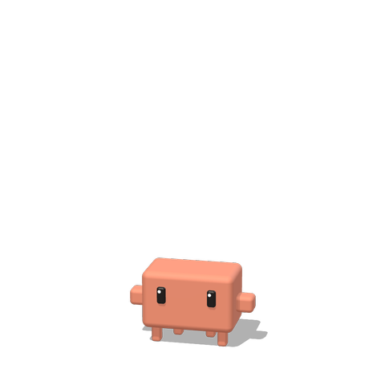
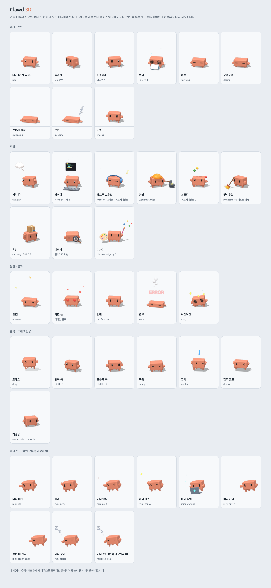

<div align="center">



# Clawd 3D

[Clawd on Desk](https://github.com/rullerzhou-afk/clawd-on-desk) 기본 캐릭터 **Clawd**를 3D로 새로 만든 커스텀 테마입니다.<br>
2D 테마에 있는 상태, 반응, 미니 모드 애니메이션을 three.js 3D 리그로 모두 다시 렌더했습니다.

</div>

---

## 미리보기

### 작업

<table>
  <tr>
    <td align="center"><br><sub>생각 중</sub></td>
    <td align="center"><br><sub>타이핑</sub></td>
    <td align="center"><br><sub>헤드폰 그루브</sub></td>
    <td align="center"><br><sub>건설 (3세션+)</sub></td>
    <td align="center"><br><sub>저글링</sub></td>
  </tr>
  <tr>
    <td align="center"><br><sub>빗자루질 (압축)</sub></td>
    <td align="center"><br><sub>운반 (워크트리)</sub></td>
    <td align="center"><br><sub>디버거</sub></td>
    <td align="center"><br><sub>디자인</sub></td>
    <td align="center"><br><sub>게걸음</sub></td>
  </tr>
</table>

### 알림과 결과

<table>
  <tr>
    <td align="center"><br><sub>완료!</sub></td>
    <td align="center"><br><sub>하트 눈</sub></td>
    <td align="center"><br><sub>알림</sub></td>
    <td align="center"><br><sub>오류</sub></td>
    <td align="center"><br><sub>어질어질</sub></td>
  </tr>
</table>

### 대기와 수면

<table>
  <tr>
    <td align="center"><br><sub>두리번</sub></td>
    <td align="center"><br><sub>비눗방울</sub></td>
    <td align="center"><br><sub>독서</sub></td>
    <td align="center"><br><sub>하품</sub></td>
    <td align="center"><br><sub>꾸벅꾸벅</sub></td>
  </tr>
  <tr>
    <td align="center"><br><sub>쓰러져 잠듦</sub></td>
    <td align="center"><br><sub>수면</sub></td>
    <td align="center"><br><sub>기상</sub></td>
    <td align="center"><br><sub>대기 (커서 추적)</sub></td>
    <td></td>
  </tr>
</table>

### 클릭·드래그 반응과 미니 모드

<table>
  <tr>
    <td align="center"><br><sub>드래그</sub></td>
    <td align="center"><br><sub>왼쪽 콕</sub></td>
    <td align="center"><br><sub>짜증</sub></td>
    <td align="center"><br><sub>깜짝 점프</sub></td>
    <td align="center"><br><sub>미니 빼꼼</sub></td>
  </tr>
</table>

<details>
<summary>전체 컨택트 시트</summary>



</details>

`docs/preview.html` 갤러리에서는 모든 애니메이션을 볼 수 있습니다. 대기 화면의 커서 추적도 앱과 같은 방식으로 체험할 수 있습니다. 보는 방법은 [갤러리로 미리보기](#갤러리로-미리보기)에 있습니다.

---

## 설치

**필요한 것:** [Clawd on Desk](https://github.com/rullerzhou-afk/clawd-on-desk) 1.6 이상

### 방법 1: 설치 스크립트 (Node.js 18 이상)

```bash
git clone https://github.com/NicoDora/clawd-3d-pet.git
```

```bash
cd clawd-3d-pet && node scripts/install-theme.mjs
```

이 스크립트는 운영체제에 맞는 사용자 테마 폴더에 `theme/clawd-3d`를 복사합니다.

### 방법 2: 직접 복사

`theme/clawd-3d` 폴더를 통째로 아래 위치에 복사합니다.

| OS | 경로 |
| --- | --- |
| macOS | `~/Library/Application Support/clawd-on-desk/themes/clawd-3d/` |
| Windows | `%APPDATA%\clawd-on-desk\themes\clawd-3d\` |
| Linux | `~/.config/clawd-on-desk/themes/clawd-3d/` |

### 테마 적용

1. Clawd on Desk 트레이 메뉴에서 **설정…** 을 엽니다.
2. **테마**에서 **Clawd 3D**를 고릅니다. 목록에 없으면 앱을 다시 시작합니다.

> 3D 렌더 결과물을 쓰기 때문에 **펫 색상(tint)과 액세서리 커스터마이징은 꺼져 있습니다.**

---

## 상태 매핑

앱 상태와 애니메이션의 대응은 기본 Clawd 테마와 같습니다.

| 앱 상태 | 애니메이션 |
| --- | --- |
| idle | 대기 (커서 추적). 가끔 두리번, 비눗방울, 독서가 랜덤으로 나옵니다 |
| thinking | 생각 중 |
| working | 세션 1개: 타이핑 · 2개: 헤드폰 그루브 · 3개 이상: 건설 |
| juggling (서브에이전트) | 1개: 헤드폰 그루브 · 2개 이상: 저글링 |
| sweeping / carrying | 빗자루질 (컨텍스트 압축) / 운반 (워크트리) |
| attention / notification / error | 완료! / 알림 / 오류 |
| yawning → dozing → collapsing → sleeping → waking | 하품 → 꾸벅꾸벅 → 쓰러져 잠듦 → 수면 → 기상 |
| 클릭 / 드래그 / 연타 | 왼쪽·오른쪽 콕, 드래그, 짜증, 깜짝 · 깜짝 점프 |
| 미니 모드 | 미니 대기, 빼꼼, 알림, 완료, 작업, 진입, 수면 (왼쪽 가장자리용 반전 포함) |

---

## 직접 렌더하기 (개발)

모든 애니메이션은 코드로 정의되어 있습니다. 렌더러는 헤드리스 Chrome에서 프레임을 뽑아 APNG로 인코딩합니다.

**필요한 것:** Node.js 18 이상, Google Chrome, `ffmpeg`

```bash
npm install
```

```bash
npm run render
```

```bash
npm run build
```

```bash
npm run install-theme
```

| 명령 | 하는 일 |
| --- | --- |
| `npm run render` | 모든 애니메이션을 `out/`에 렌더 (960px로 렌더 후 480px APNG로 인코딩) |
| `node render.mjs --out out --only happy,error` | 지정한 애니메이션만 렌더 |
| `node render.mjs --out out --still happy@0.8,idle:eyes@0` | 특정 시점의 스틸 PNG를 렌더 (`이름[:레이어]@초`) |
| `npm run build` | `out/`의 결과물로 `theme/clawd-3d`(theme.json, 에셋)를 다시 생성 |
| `npm run install-theme` | 앱의 사용자 테마 폴더에 설치 |

Chrome이 다른 위치에 있으면 `CHROME_PATH` 환경 변수로 실행 파일 경로를 지정합니다.

### 갤러리로 미리보기

```bash
npm run preview
```

서버를 띄운 뒤 브라우저에서 `http://localhost:8080/docs/preview.html`을 엽니다.

### 프로젝트 구조

```
src/rig.js          3D 리그: 몸통·팔·다리·눈 변형, 소품, 조명, 카메라 (three.js)
src/anims.js        애니메이션 정의. 순수 함수 fn(t, R)로 각 프레임의 포즈를 계산
index.html          렌더 스튜디오 페이지 (window.renderFrame / exportVector)
render.mjs          헤드리스 Chrome으로 프레임을 렌더해 ffmpeg로 APNG 인코딩
build-theme.mjs     렌더 결과물로 theme.json과 커서 추적용 idle SVG를 조립
scripts/            설치 스크립트
tools/              QA 도구 (2D 원본 비교, <object> 추적 테스트, 스틸 타일링 등)
theme/clawd-3d/     완성된 테마 (theme.json + assets 43개)
docs/               미리보기 갤러리, 컨택트 시트
```

### 애니메이션 추가·수정

1. `src/anims.js`에 `이름: { dur, fps, loop, fn(t, R) { ... } }` 형태로 애니메이션을 정의합니다. `R`은 리그 API입니다(`height`, `yaw`, `squash`, `arm`, `leg`, `eyes`, `blink`, `look`, `show` 등).
2. `node render.mjs --out out --still 이름@0.5`로 포즈를 확인합니다.
3. `node render.mjs --out out --only 이름`으로 렌더합니다.
4. 새 상태에 연결하려면 `build-theme.mjs`의 `theme` 객체(states, reactions, miniMode 등)를 고친 뒤 `npm run build`를 실행합니다.
5. 업스트림 저장소의 검증기로 확인합니다: `node <clawd-on-desk>/scripts/validate-theme.js theme/clawd-3d`

### 커서 추적 대기 화면

대기 상태는 APNG 대신 `clawd3d-idle-follow.svg`를 씁니다. 이 파일은 그림자, 몸통, 눈을 따로 렌더한 3장의 레이어를 SVG로 합성합니다. 앱은 `#eyes-js`, `#body-js`, `#shadow-js`를 움직여 커서를 따라가게 하고, 숨쉬기와 눈 깜빡임은 CSS 애니메이션이 처리합니다. 래스터를 불러올 수 없는 `` 환경(설정 썸네일 등)에서는 3D 박스를 투영한 벡터 폴리곤이 대신 보입니다.

---

## 크레딧

- 원작 앱과 Clawd 캐릭터 디자인: [rullerzhou-afk/clawd-on-desk](https://github.com/rullerzhou-afk/clawd-on-desk) (AGPL-3.0)
- 3D 렌더: [three.js](https://threejs.org/), [Puppeteer](https://pptr.dev/), [FFmpeg](https://ffmpeg.org/)
- 이 테마는 원작 2D 애니메이션을 참고해 새로 모델링했으며, Claude Code로 제작했습니다.
